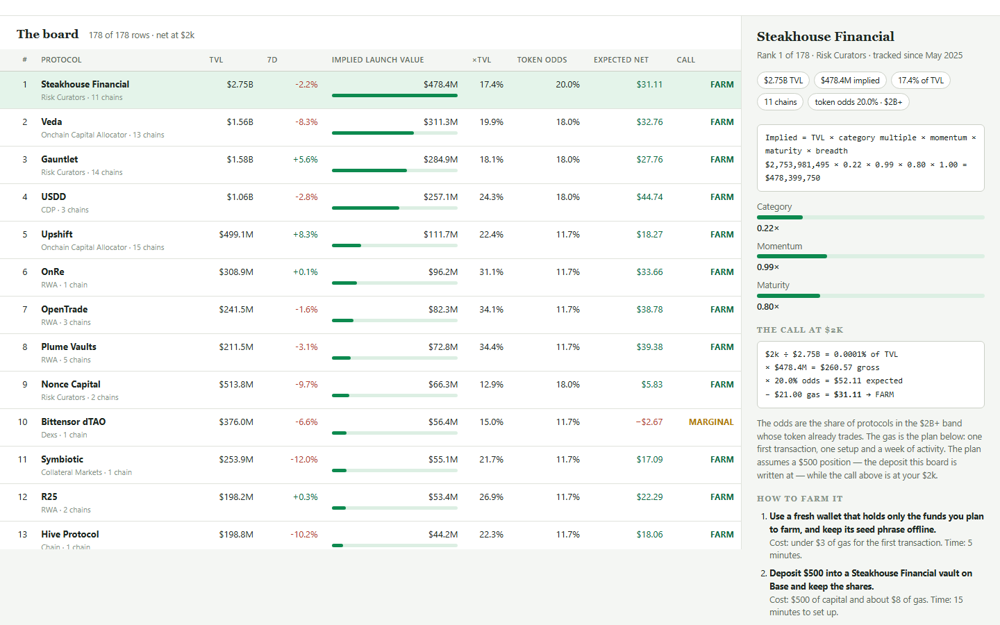

# Token Radar

An entry for [make.fun](https://make.fun)'s `token-radar-01`
([bounty page](https://make.fun/bounty/token-radar-01)): a dashboard that ranks the
protocols which still record no token by what their launch would be worth, gives every
row a call, and puts the model on trial in front of the reader with numbers taken from
the same sealed snapshot.

## The claim the page makes

    implied = TVL × multiple(category) × momentum × maturity

- **multiple(category)** — 0.12× for a farm up to 0.55× for a perp DEX. A dollar of TVL is
  rent the protocol charges on other people's capital, and a market pays more for a DEX's
  or a perp DEX's fee stream than for a restaking layer's or a bridge's thin spread.
- **momentum** — the snapshot's seven-day TVL change, clamped to −60%…+120% and damped by
  0.5, so one good week cannot double a rank and one red week cannot zero it.
- **maturity** — 0.6…1.0×, rising with how long DefiLlama has tracked the protocol.

`radar-2` also carried a **breadth** premium, 1 + 0.03 a chain. This version drops it, and
the dashboard shows why rather than saying so.

## The model is on trial, in the page

Three questions, each answered from the snapshot and printed on the page:

1. **How wrong is it?** The 119 protocols that already record a token are a hold-out: the
   same formula is run on them and compared with the market value the market gives them.
   Median miss **×4.27**, middle half ×1.96–×10.88, 30 of 119 within ×2, 63 within ×5. The
   outliers are the tokens that trade far above their protocol's TVL — a chain's own coin,
   a memecoin — and the page says so instead of hiding them.
2. **Which factors earn their place?** Each is switched off and the hold-out re-scored:
   category ×5.24, momentum ×4.37, maturity ×4.59 against ×4.27 for the full model, so all
   three stay. Breadth is put *back* at its old weight and comes out at ×4.77 — worse — so
   it is the one factor dropped, and that is the whole of the change from `radar-2`.
3. **How often does a token appear at all?** For each TVL band, the share of protocols in it
   whose token already trades with a market value: 18.6% at $5–10M, 16.7% at $10–50M, 19.8%
   at $50–100M, 11.7% at $100–500M, 18.0% at $500M–2B, 20.0% above $2B. Observed, not assumed.

## The call, on every row

Rank is the model's claim about value. The **call** is a different question, and it is
computed for the reader's own deposit:

    net = (deposit ÷ TVL) × implied value × token odds − gas of the farm plan
    FARM at +$5 or better · MARGINAL within ±$5 · SKIP below −$5

At the board's default $500 deposit that is 13 rows FARM, 77 MARGINAL and 88 SKIP; the
deposit slider moves rows between the three, so a reader can see at which size a protocol
stops being worth the gas. Every row's detail view prints that arithmetic line by line.

## Integrity, printed on the page

- `758 protocols read = 178 ranked + 335 with a token + 91 wrapped + 56 exchanges + 78 versioned pools + 20 past the early cap`
- ranks 1–178 once each, implied value never rising as rank ascends
- a **seal**: the sha256 of every row's (rank, slug, implied value), so the table on screen
  can be checked against the table that was written

## The dashboard

Static files, no framework, no network. Controls: search, chain, TVL floor, call filter
(FARM / MARGINAL / SKIP), deposit slider, category chips, sortable columns, CSV export of
whatever is on screen. Clicking a row opens its multipliers, its arithmetic, its chains and
its farm plan with a cost and a time per step.

## Run it

    MAKEFUN_OUTPUT_DIR=out node main.ts --input ../input/snapshot.json

Node 22.18 or later; standard library only. It writes `board.json`, `data.js`,
`dashboard/`, `screenshots/` and the `dossier.json` the judge reads, and it prints the
hold-out's median miss and the seal when it finishes.

`tools/shoot.py` renders the three screenshots from one tall capture of the page.

## Files

- `main.ts` — the program
- `lib/model.ts` — the model, the hold-out, the ablations, the odds, the calls and the ledger
- `dashboard/` — `index.html`, `app.css`, `app.js`
- `screenshots/` — the evidence sheet, a detail view and a filtered view
- `vendor/makefun-board.ts` — the make.fun library, unchanged

Licensed MIT.
